<div align="center">




</div>

## 🎯 The problem

Aluminium window makers, steel fabricators, joiners, kitchen and furniture makers, glass shops and tailors all cut
pieces from stock: profiles from 6 m bars, panels from 2440 × 1220 boards, glass from large plates. Which pieces go
on which bar or sheet is usually decided **by hand**, at the saw: longest piece first, into the first bar with room.
It is quick, but on a real order it often needs **a bar or a sheet more than necessary**, leaves offcuts nobody can
use, and nobody knows how good the plan was.

**Cut Planner** plans the cuts for the whole order: the **fewest bars and sheets** (or the lowest material cost when
stock has different prices), with the saw kerf, edge trim, grain direction and offcuts from earlier jobs taken into
account. It prints **cutting diagrams** for the workshop, writes the **cut list**, lists the **offcuts worth keeping**,
shows the **money saved**, and often **proves** that no plan can use less.

## ✨ What it does

| Tab | What you get |
|---|---|
| 📥 **Job** | a demo (aluminium windows, kitchen cabinets) or your own Excel job: stock with prices and counts, pieces, saw kerf, trim, grain |
| ⚙️ **Plan** | the plan in seconds, checked by independent code, with the stock to take and a lower bound: *proven least* when the plan reaches it |
| ✂️ **Cutting diagrams** | every bar and sheet pattern, how many times to cut it, first cuts numbered; **cut sheets as PDF**, the cut list as Excel, and ♻️ the **offcuts to keep**, added to the next job's stock in one click |
| 💰 **Savings** | material and money saved against cutting by hand, per job and per year, and both plans side by side |
| 🧪 **Benchmark** | the results on 1,615 bar and 500 sheet benchmark instances |
| ℹ️ **How it works** | the method in plain words, with references |

## 📸 The app

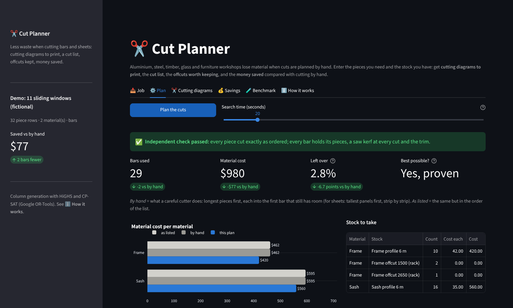

| **The job: stock, pieces, kerf and trim** | **The plan vs cutting by hand** |
|:---:|:---:|
| 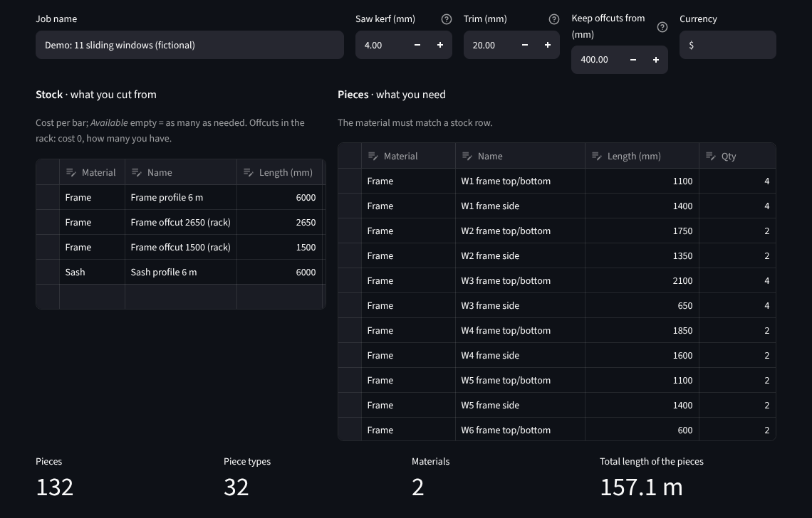 | 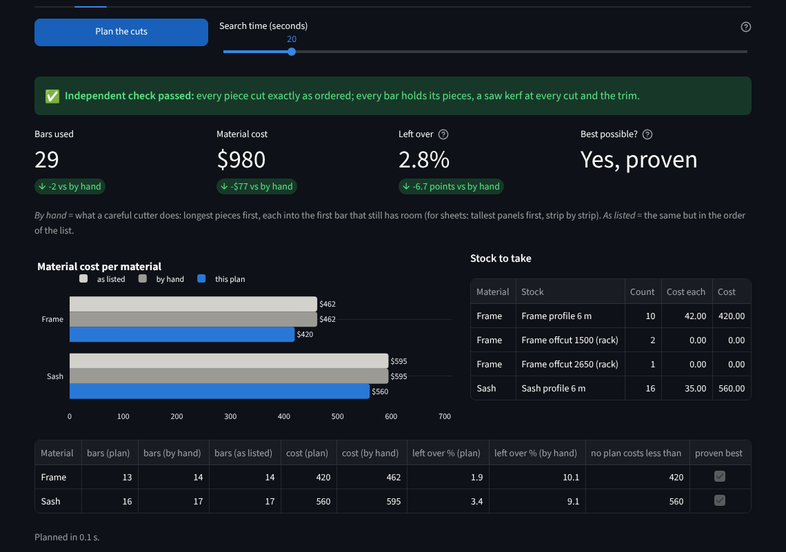 |
| **Bar patterns** | **Sheet patterns (guillotine cuts)** |
| 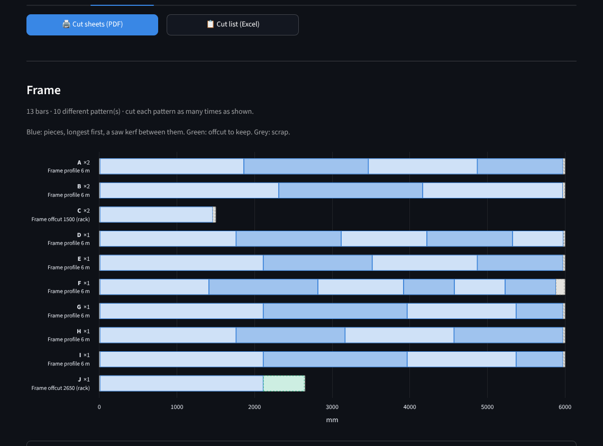 | 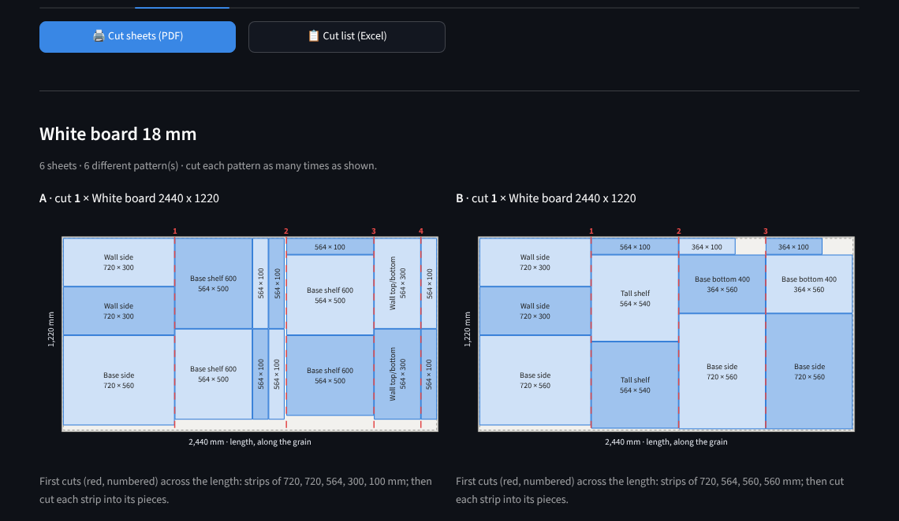 |
| **Savings per job and per year** | **By hand and the plan, side by side** |
| 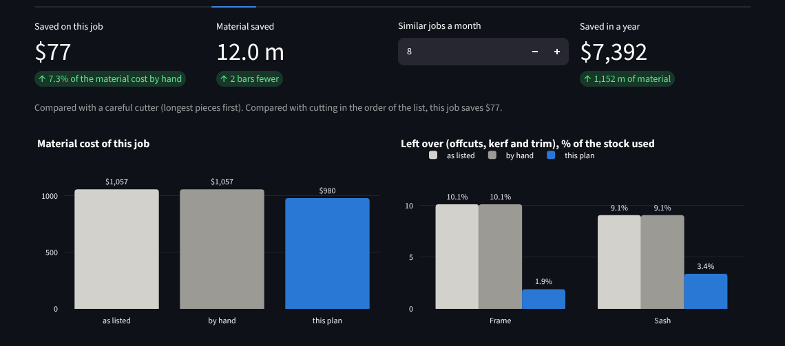 | 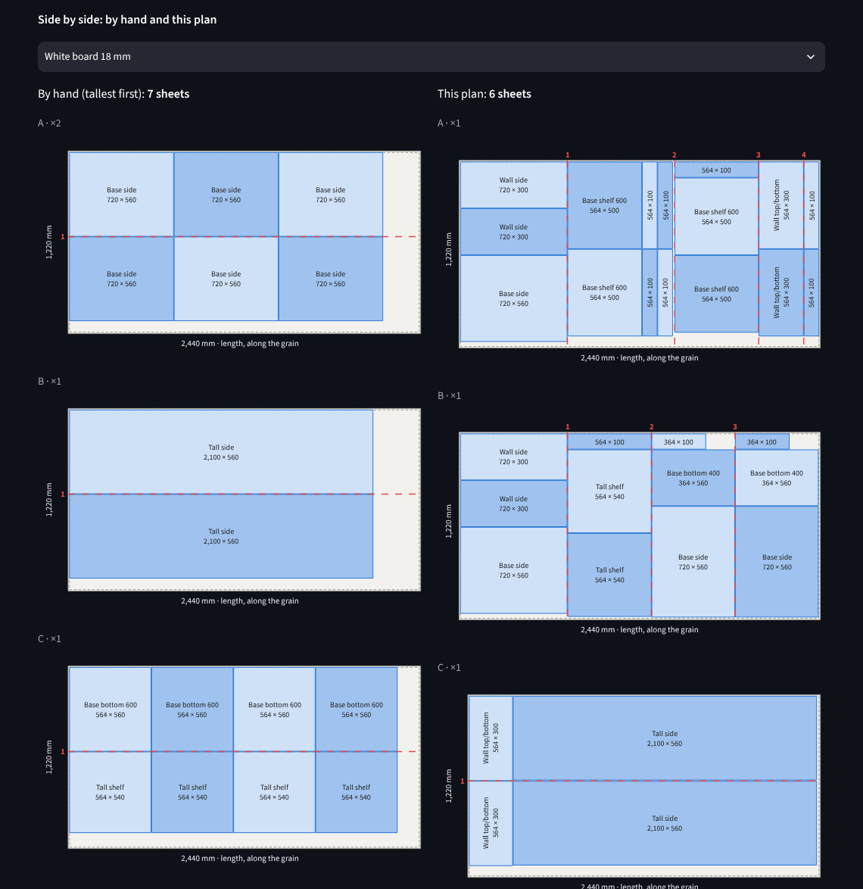 |

**Printed for the workshop** (the PDF cut sheets): one page per sheet pattern with the count and boxes to tick, and
the bar patterns eight to a page.

| **A sheet pattern** | **Bar patterns** |
|:---:|:---:|
| 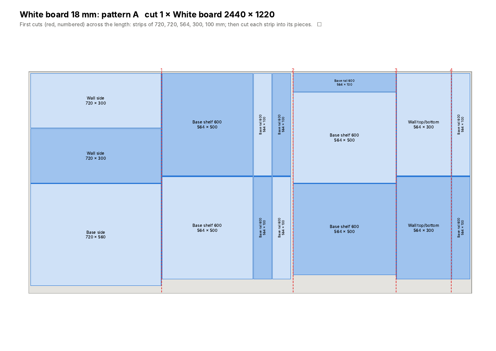 | 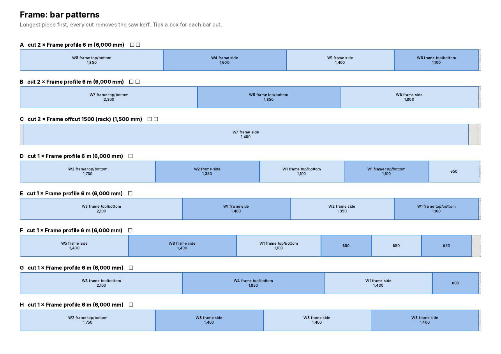 |

## 🪵 Sheets: one less, proven


Sheets are cut the way a panel saw or a glass cutter works: rip the sheet into strips, cut the strips into pieces,
every cut straight from edge to edge (guillotine cuts). Panels with a grain keep it along the sheet's length; the
others may turn. The independent checker proves every sheet can really be cut that way.

## 🧪 Benchmark


**Bars.** [BPPLIB](https://github.com/mdelorme2/BPPLIB) (Delorme, Iori & Martello, 2018) collects the standard
cutting stock and bin packing test sets; every one of these 1,615 instances has a **proven optimal** number of bars.
Each was planned for at most 20 seconds on one thread, and every plan passed the independent checker.

| Family | Instances | Optimum matched | By hand (first fit decreasing) |
|---|---:|---:|---:|
| Falkenauer (uniform and triplets) | 160 | **160** | 6 |
| Scholl (sets 1 to 3) | 1,210 | **1,200** | 782 |
| Wäscher | 17 | **17** | 2 |
| Schwerin | 200 | **200** | 0 |
| Hard28 | 28 | **26** | 5 |
| **All** | **1,615** | **1,603** (99.3%) | 795 (49%) |

1,594 plans are proven optimal by the planner itself (plan = lower bound); the median time is 0.14 s. The 12 misses
are the 10 Scholl *HARD* instances (+1 to +4 bars; built to be hard, with bars of length 100,000) and 2 of Hard28
(+1).

**Sheets.** The 500 CLASS instances (Berkey & Wang 1987, Martello & Vigo 1998; panels may not turn) have no proven
optimum for every instance, so plans are compared with a lower bound and with cutting by hand strip by strip:
Cut Planner used **7,433** sheets in total, cutting by hand **7,545**, and the lower bound is 6,830 (often below
the true optimum). **167** plans equal the bound and are therefore optimal; the plan needs fewer sheets than by
hand on 109 instances and never more. Each instance had 10 seconds.

## 🧠 How it works


| Step | In plain words |
|---|---|
| **Patterns** | A pattern is one way to cut one bar or sheet. The plan says how many times to cut each pattern. |
| **Column generation** (Gilmore & Gomory, 1961) | A linear program (HiGHS, warm-started) picks the cheapest mix of known patterns and puts a price on every piece; a knapsack then finds the pattern worth most at those prices. Repeated until no pattern helps. |
| **Lower bound** | The linear program's final value: no plan can cost less. For sheets also the panels' area and panels too big to share a sheet. |
| **Integer plan** | Diving (fix the patterns used most, solve the rest again, randomised repeats) and CP-SAT (Google OR-Tools) over every pattern found. Equal to the bound means **proven least**. |
| **Sheets** | A three-level knapsack builds the best guillotine layout (best stack for each column width, best strip for each height, best set of strips), in both directions of the sheet; *sequential value correction* gives awkward panels more weight in the next round. |
| **Independent check** | Separate code re-checks every plan: every piece cut exactly as ordered, every bar within its length with kerf and trim, every panel inside the trimmed sheet with kerf between panels, grain kept, stock limits kept, and every sheet cuttable with straight edge-to-edge cuts. |

## 🚀 Quick start

```bash
git clone https://github.com/harshadulshan/cut-planner.git
cd cut-planner
pip install -r requirements.txt
streamlit run app.py
```

Click **Load the window demo** or **Load the kitchen demo**, then **⚙️ Plan → Plan the cuts**. For your own job, fill
in [`sample_data/bars_template.xlsx`](sample_data/bars_template.xlsx) or
[`sample_data/sheets_template.xlsx`](sample_data/sheets_template.xlsx) (the fictional demos) and upload it.

## ✅ Verified

```bash
python tests/verify_engine.py       # 52 checks: brute force, kerf, trim, stock limits, grain, checker, Excel
python tests/verify_app.py          # 21 checks: clicks through every tab with both demos
python tests/mutation_test.py       # 15 planted bugs, each must be caught
python benchmarks/run_benchmark.py bars     # 1,615 instances, needs: pip install libarchive-c
python benchmarks/run_benchmark.py sheets   # 500 instances
```

- **Exact on small jobs:** on 30 random bar jobs (one or two stock lengths with prices, kerf, trim) the plan always
  costs exactly the optimum found by trying every way to split the pieces, and the lower bound never exceeds it.
- **Published optima reproduced:** 1,603 of the 1,615 BPPLIB instances.
- **Mutation test:** 15 bugs planted one at a time (the checker forgetting the kerf or the grain, the solver ignoring
  the trim, offcuts used beyond what the rack holds, a lower bound one bar too high, ...). All caught.

## ⚠️ Limitations

- Bars are cut square: mitred ends are planned at their full length.
- Sheets use staged guillotine cuts (strips, then pieces); free nesting of irregular shapes is not covered.
- Prices, kerf, trim and the offcut threshold are yours to set; the demo prices and orders are made up.

Data: BPPLIB by M. Delorme, M. Iori and S. Martello (instances are downloaded from a pinned commit and checked by
SHA-256, not bundled); CLASS instances from [OR-Datasets](https://github.com/Oscar-Oliveira/OR-Datasets) (MIT). The
demo orders are fictional.
